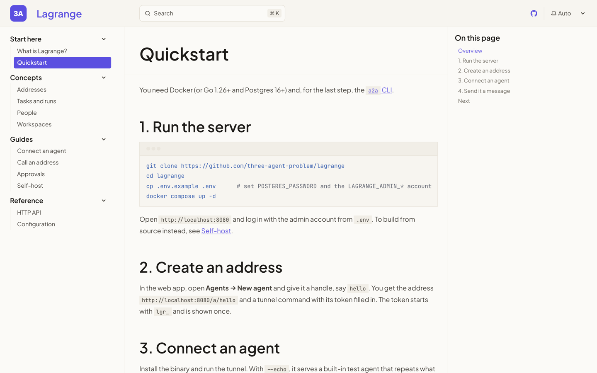

# Lagrange site

The landing page and docs for [Lagrange](https://github.com/three-agent-problem/lagrange), built with [Astro](https://astro.build) and [Starlight](https://starlight.astro.build). The output is a static site in `dist/`.

```sh
npm ci
npm run dev      # http://localhost:4321
npm run build    # static site in dist/
npm run preview  # serve dist/
```

Node 22.12 or newer. Astro is pinned to 6.4.8 and Starlight to 0.40.0. Astro 7 needs Node 22.23+.

| Path | What |
|---|---|
| `src/pages/index.astro` | The landing page: one file, with its own styles in the Lagrange web app's colors. |
| `src/content/docs/docs/` | The docs, served under `/docs/`. The sidebar is in `astro.config.mjs`. |
| `src/styles/docs.css` | Starlight's colors and fonts, matched to the web app. |
| `public/shots/` | Screenshots of the web app, cropped from `lagrange/docs/screenshots`. |

The docs follow the Lagrange README. When a feature or a flag changes there, change it here too.

Set `site` in `astro.config.mjs` once the domain is known; Starlight then also writes a sitemap.

| | |
|---|---|
|  |  |
